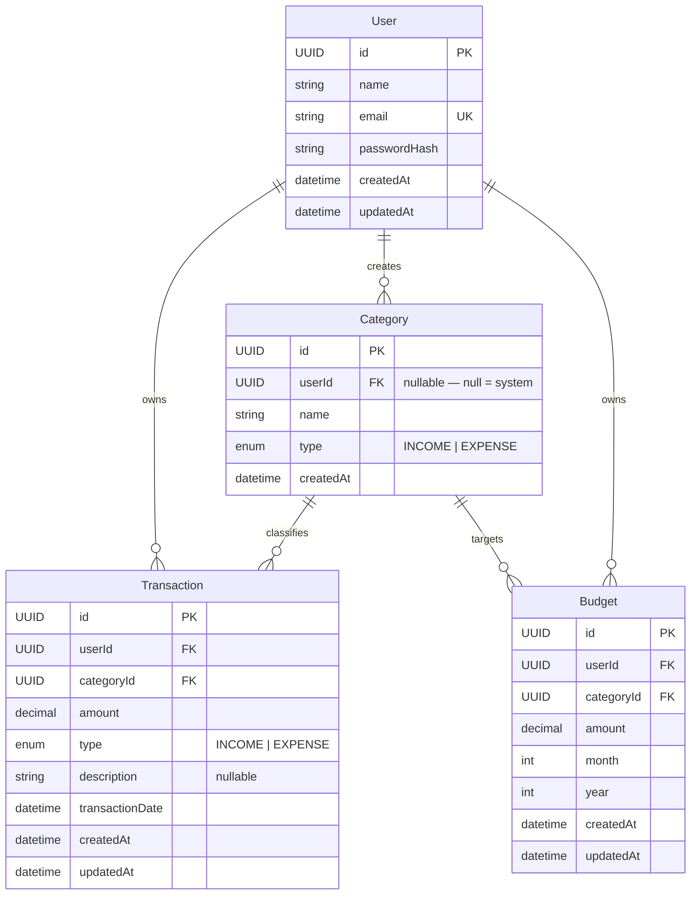

# SpendWise — Personal Finance Manager

A production-oriented full-stack personal finance management application built with Next.js, Express, TypeScript, and PostgreSQL.

---

## Features

- **Authentication** — Argon2id password hashing, HttpOnly cookie sessions, rate-limited login
- **Transactions** — Full CRUD with pagination, search, date range, category and type filters
- **Categories** — 13 system defaults + custom categories per user
- **Budgets** — Monthly spending limits with live utilization, warnings, and over-budget alerts
- **Analytics** — Dashboard summary, monthly income/expense trend, category breakdown, budget utilization
- **Security** — IDOR prevention on every resource, user-scoped queries, Helmet, CORS, rate limiting
- **Dark theme UI** — Tailwind CSS, Recharts visualizations, responsive layout

---

## Architecture

```
SpendWise/
├── frontend/          Next.js 14 App Router + TypeScript
├── backend/           Express 5 + TypeScript + Prisma 7
├── docker-compose.yml PostgreSQL containers (dev + test)
├── .env.example       Root env template
└── README.md
```

### Backend modules

```
backend/src/
├── config/          env.ts, prisma.ts (driver adapter)
├── middleware/      auth, error handler, Zod validator
├── modules/
│   ├── auth/        register, login, logout, /me
│   ├── categories/  CRUD (system + user-owned)
│   ├── transactions/ CRUD, pagination, filters, IDOR guards
│   ├── budgets/     CRUD, live spending calculation
│   └── analytics/   dashboard, trend, breakdown, utilization
├── utils/           response helpers, pagination
└── types/           Express request augmentation
```

---

## Database ER Diagram



---

## API Documentation

Base URL: `http://localhost:3001/api/v1`

All protected routes require a valid `spendwise_session` cookie (set automatically on login/register).

### Response format

```json
// Success
{ "success": true, "data": {}, "message": "Operation successful", "meta": {} }

// Error
{ "success": false, "message": "Invalid request", "code": "VALIDATION_ERROR" }
```

### Auth

| Method | Path | Auth | Description |
|--------|------|------|-------------|
| POST | /auth/register | — | Register new user |
| POST | /auth/login | — | Login |
| POST | /auth/logout | ✓ | Logout |
| GET | /auth/me | ✓ | Current user |

### Transactions

| Method | Path | Description |
|--------|------|-------------|
| GET | /transactions | List (page, limit, type, categoryId, search, startDate, endDate, sortBy, sortOrder) |
| POST | /transactions | Create |
| GET | /transactions/:id | Get one |
| PATCH | /transactions/:id | Update |
| DELETE | /transactions/:id | Delete |

### Categories

| Method | Path | Description |
|--------|------|-------------|
| GET | /categories | List (system + user-owned) |
| POST | /categories | Create custom category |
| GET | /categories/:id | Get one |
| PATCH | /categories/:id | Update (user-owned only) |
| DELETE | /categories/:id | Delete (user-owned only) |

### Budgets

| Method | Path | Description |
|--------|------|-------------|
| GET | /budgets?year=&month= | List with live spending |
| POST | /budgets | Create |
| GET | /budgets/:id | Get one |
| PATCH | /budgets/:id | Update |
| DELETE | /budgets/:id | Delete |

### Analytics

| Method | Path | Description |
|--------|------|-------------|
| GET | /analytics/dashboard?year=&month= | Summary (balance, income, expenses, savings) |
| GET | /analytics/monthly-trend?months= | Monthly income/expense trend |
| GET | /analytics/category-breakdown?year=&month=&type= | Per-category totals |
| GET | /analytics/spending?period=daily|monthly|yearly&year=&month= | Spending by period |
| GET | /analytics/budget-utilization?year=&month= | Budget vs. actual |

---

## Financial Calculation Definitions

| Metric | Formula |
|--------|---------|
| Total Balance | Sum(all INCOME) − Sum(all EXPENSE) |
| Monthly Savings | Sum(INCOME in month) − Sum(EXPENSE in month) |
| Budget Remaining | Budget.amount − Sum(EXPENSE in category+month) |
| Budget Utilization % | (spent / budget) × 100 |

Monetary amounts are stored as `Decimal(15,2)` in PostgreSQL and serialised as strings with exactly 2 decimal places in all API responses. No JavaScript floating-point arithmetic is used for financial calculations.

---

## Authentication Design

1. User registers/logs in → server hashes password with Argon2id.
2. Server generates a 128-hex cryptographic token and stores it in an in-memory Map with a 7-day expiry.
3. Token is set as an `HttpOnly; SameSite=Lax; Secure` (in production) cookie named `spendwise_session`.
4. Every protected request reads the cookie, validates the token, and loads the user from the database.
5. Logout deletes the session from the Map and clears the cookie.

> **Production note**: Replace the in-memory session store with Redis for horizontal scaling.

---

## Installation

### Prerequisites

- Node.js 20+
- Docker Desktop
- npm 10+

### Quick start

```bash
# 1. Clone and enter the repo
git clone <repo-url> SpendWise && cd SpendWise

# 2. Start PostgreSQL
docker compose up -d postgres

# 3. Configure backend
cd backend
cp .env.example .env
# Edit DATABASE_URL port to match docker-compose (5434 by default if 5432 is taken)

# 4. Run migrations and seed
npm install
npm run db:generate
npm run db:migrate
npm run db:seed

# 5. Start backend
npm run dev   # http://localhost:3001

# 6. Configure and start frontend (new terminal)
cd ../frontend
cp ../.env.example .env.local
# NEXT_PUBLIC_API_URL=http://localhost:3001
npm install
npm run dev   # http://localhost:3000
```

---

## Environment Variables

### Backend (`backend/.env`)

| Variable | Description | Default |
|----------|-------------|---------|
| `DATABASE_URL` | PostgreSQL connection string | — |
| `SESSION_SECRET` | Session signing secret (≥32 chars) | — |
| `PORT` | Backend port | 3001 |
| `NODE_ENV` | Environment | development |
| `FRONTEND_URL` | CORS origin | http://localhost:3000 |

### Frontend (`frontend/.env.local`)

| Variable | Description | Default |
|----------|-------------|---------|
| `NEXT_PUBLIC_API_URL` | Backend API base URL | http://localhost:3001 |

---

## Docker

```bash
# Start dev database only
docker compose up -d postgres

# Start both databases (dev + test)
docker compose up -d

# Stop
docker compose down

# Destroy volumes
docker compose down -v
```

The dev database maps to port **5434** (adjustable via `DB_PORT` env var if 5432 is in use).

---

## Migration Commands

```bash
cd backend

# Generate Prisma client
npm run db:generate

# Create and apply a new migration
npm run db:migrate

# Seed default categories
npm run db:seed

# Open Prisma Studio
npm run db:studio
```

---

## Testing

```bash
cd backend

# Run all tests (25 tests)
npm test

# Watch mode
npm run test:watch
```

Tests cover:
- Auth registration, duplicate email, login, invalid credentials, protected routes
- Transaction CRUD, pagination, type filtering
- IDOR security: cross-user read/modify/delete attempts
- Budget creation, duplicate prevention, spending calculations
- Analytics: correct income/expense totals, balance formula, monthly trend, category breakdown

---

## Deployment

### Database
Provision a managed PostgreSQL instance (e.g. Supabase, Railway, Neon).

### Backend
```bash
cd backend
npm run build        # Outputs to dist/
NODE_ENV=production npm start
```
Set all required env vars. Use a process manager (PM2) or container.

Replace the in-memory session store with Redis (`ioredis`) for multi-instance deployments.

### Frontend
```bash
cd frontend
npm run build
npm start
```
Deploy to Vercel, Netlify, or any Node-capable host. Set `NEXT_PUBLIC_API_URL` to the production backend URL.

---

## Known Limitations

1. **In-memory sessions** — Sessions are stored in a `Map` in the backend process. They are lost on server restart and do not work across multiple instances. Replace with Redis for production.
2. **No refresh tokens** — Sessions are fixed 7-day cookies. Implement refresh token rotation for tighter security.
3. **No email verification** — Registration does not verify email addresses.
4. **No password reset** — No forgot-password / reset flow.
5. **No CSRF tokens** — `SameSite=Lax` cookies provide CSRF protection for same-origin navigation but not for cross-site form submissions in edge cases. Add CSRF tokens for a stricter posture.
6. **Argon2 native module** — `argon2` requires a C++ build toolchain. If deployment fails, switch to `bcryptjs`.

---

## Suggested Next Improvements

- Replace in-memory sessions with Redis
- Add email verification on registration
- Implement password reset via email
- Add recurring transaction support
- Export transactions to CSV / PDF
- Add multi-currency support
- Build a mobile-responsive PWA
- Add webhook notifications for budget alerts
- Implement per-user data export (GDPR)
- Add two-factor authentication
