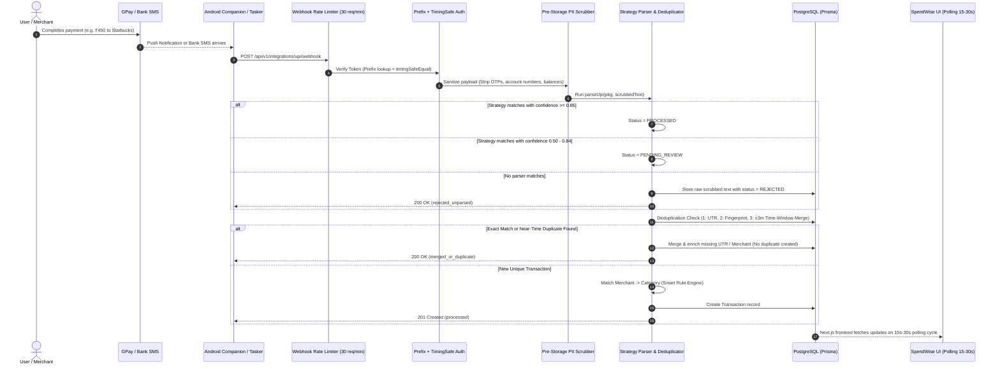

# Live Google Pay (UPI) Integration for SpendWise
## Architectural Specification & Implementation Plan (Refined v2.0)

---

## 1. Executive Summary & Core Strategy

Google Pay (UPI) does not provide a personal transaction API. The robust, battle-tested approach to live syncing is **capturing incoming push notifications and bank debit SMS alerts on the user's Android device and streaming them to a secure SpendWise ingestion webhook**.

### 1.1 Scope & Priorities (Channel A First)
We focus exclusively on **Channel A (Instant Android Notification / SMS Ingestion)** via Tasker / MacroDroid recipes and a lightweight companion listener:
- **Phase 1 Priority (Channel A)**: Webhook endpoint + Strategy-based Parser + Dual-layer Deduplication + Auto-Categorizer + Token Auth.
- **Future Add-ons (Post-Launch)**: Channel B (Gmail Pub/Sub) and Channel C (CSV/PDF statement upload) are parked as future milestones.

---

## 2. Ingestion Flow & System Architecture



---

## 3. Database Schema Changes (Prisma)

### 3.1 Enhanced Schema (`backend/prisma/schema.prisma`)

```prisma
// Enum for transaction source
enum TransactionSource {
  MANUAL
  GPAY_NOTIFICATION
  BANK_SMS
  GMAIL_RECEIPT
  CSV_IMPORT
}

// Enum for transaction review & sync status
enum SyncStatus {
  PROCESSED       // Full parse confidence (amount + type + merchant)
  PENDING_REVIEW  // Partial confidence (amount found, merchant/type uncertain)
  REJECTED        // Unparseable or non-financial alert (retained for parser tuning)
}

model Transaction {
  id              String            @id @default(uuid())
  userId          String
  categoryId      String
  amount          Decimal           @db.Decimal(15, 2)
  type            TransactionType
  description     String?
  transactionDate DateTime
  createdAt       DateTime          @default(now())
  updatedAt       DateTime          @updatedAt
  
  // UPI Ingestion Fields
  source          TransactionSource @default(MANUAL)
  externalId      String?           // 12-digit UPI UTR / Bank reference number (nullable)
  fingerprint     String?           // sha256(userId + amount + type + normalizedMerchant + 5min_bucket)
  merchantName    String?           // Extracted counterparty name (e.g., "Starbucks Coffee")
  rawPayload      String?           // Pre-scrubbed text (no balances, account numbers, or OTPs)
  confidence      Decimal?          @db.Decimal(3, 2) // 0.00 to 1.00 parser confidence score
  syncStatus      SyncStatus        @default(PROCESSED)

  user            User              @relation(fields: [userId], references: [id], onDelete: Cascade)
  category        Category          @relation(fields: [categoryId], references: [id])

  // Dual-Layer Deduplication Constraints & Lookups
  @@unique([userId, externalId])
  @@index([userId, fingerprint])
  @@index([userId, transactionDate, amount])
  @@index([userId])
  @@index([categoryId])
  @@index([transactionDate])
  @@index([userId, type])
  @@index([userId, source])
  @@map("transactions")
}

// Mobile companion API tokens
model IntegrationToken {
  id          String   @id @default(uuid())
  userId      String
  name        String   // e.g. "Pixel 8 Pro - Tasker"
  tokenPrefix String   // First 12 characters for O(1) indexed candidate lookup
  tokenHash   String   // SHA-256 hash of the complete raw token string
  lastUsedAt  DateTime?
  isActive    Boolean  @default(true)
  createdAt   DateTime @default(now())
  updatedAt   DateTime @updatedAt

  user        User     @relation(fields: [userId], references: [id], onDelete: Cascade)

  @@index([tokenPrefix, isActive])
  @@index([userId])
  @@map("integration_tokens")
}

// Category rules for merchant mapping
model CategoryRule {
  id         String   @id @default(uuid())
  userId     String?  // null = global default, set = user-specific override
  categoryId String
  keyword    String   // Normalized regex or string (e.g. "swiggy", "starbucks")
  priority   Int      @default(0)
  createdAt  DateTime @default(now())

  user       User?    @relation(fields: [userId], references: [id], onDelete: Cascade)
  category   Category @relation(fields: [categoryId], references: [id], onDelete: Cascade)

  @@unique([userId, keyword])
  @@index([userId])
  @@index([keyword])
  @@map("category_rules")
}
```

---

## 4. Ingestion Engine Implementation

### 4.1 In-Flight PII Pre-Scrubber (Run BEFORE DB Storage)

Before raw text is stored or processed, sensitive banking data must be stripped:

```typescript
// backend/src/modules/integrations/upi/scrubber.ts
export function scrubRawPayload(raw: string): string {
  let scrubbed = raw;

  // 1. Strip OTPs (e.g., "OTP is 492019", "code 5839")
  scrubbed = scrubbed.replace(/\b(?:otp|code|verification code|one time password)\s*(?:is|:)?\s*([0-9]{4,8})\b/gi, '[OTP_REDACTED]');

  // 2. Mask Bank Account numbers (e.g., "A/c ending 4821", "A/C **9182")
  scrubbed = scrubbed.replace(/\b(?:a\/c|acct|account)\s*(?:no\.?|number)?\s*[:#]?\s*(?:[xX*]+|ending\s+in\s+)?(\d{3,6})\b/gi, 'A/c [REDACTED]');

  // 3. Strip remaining available balances (e.g., "Avl Bal Rs 14,250.00", "Balance: INR 5000")
  scrubbed = scrubbed.replace(/\b(?:avl\s+bal|avail(?:able)?\s+bal(?:ance)?|bal(?:ance)?|tot\s+bal)\s*(?:is|:)?\s*(?:rs\.?|inr|₹)?\s*[\d,]+(?:\.\d{2})?\b/gi, '[BAL_REDACTED]');

  return scrubbed.trim();
}
```

---

### 4.2 Modular Strategy Parser Architecture

Each notification / SMS source is handled by an isolated, testable strategy implementing the `ParserStrategy` interface.

```typescript
// backend/src/modules/integrations/upi/types.ts
export type ParsedTxn = {
  amount: number;
  type: 'EXPENSE' | 'INCOME';
  merchant?: string;
  utr?: string;
  timestamp?: Date;
  confidence: number; // 0.00 to 1.00
  strategy: string;
};

export interface ParserStrategy {
  name: string;
  matches(pkg: string, text: string): boolean;
  parse(text: string, timestamp?: number): ParsedTxn | null;
}
```

#### Implemented Strategies:
1. `gpayNotificationParser`: Target package `com.google.android.apps.nbu.paisa.user`
   - Handles:
     - `"Paid ₹450.00 to Starbucks Coffee. UPI Ref: 432589012345"` -> High confidence (`1.00`)
     - `"Paid ₹450 to Starbucks Coffee"` (No UTR) -> High confidence (`0.90`)
     - `"Received ₹1,200 from Rahul Sharma"` -> Income (`0.90`)
2. `hdfcSmsParser`: Target sender `HDFCBK` / `HDFC`
   - Pattern: `"debited by Rs 450.00 on ... to VPA starbucks@hdfcbank ... UPI: 432589012345"`
3. `sbiSmsParser`: Target sender `SBIINB` / `SBIPAY`
   - Pattern: `"A/C ... debited by Rs. 250.00 on 20Nov26 transfer to ... Ref No 432589012345"`
4. `iciciSmsParser`: Target sender `ICICIB`
5. `axisSmsParser`: Target sender `AXISBK`
6. `genericUpiParser`: Fallback matcher for standard UPI terminology.

```typescript
// backend/src/modules/integrations/upi/parser.ts
import { gpayNotificationParser } from './strategies/gpay';
import { hdfcSmsParser } from './strategies/hdfc';
import { sbiSmsParser } from './strategies/sbi';
import { genericUpiParser } from './strategies/generic';
import { ParserStrategy, ParsedTxn } from './types';

const parsers: ParserStrategy[] = [
  gpayNotificationParser,
  hdfcSmsParser,
  sbiSmsParser,
  genericUpiParser,
];

export function parseUpi(pkg: string, text: string, timestamp?: number): ParsedTxn | null {
  for (const parser of parsers) {
    if (!parser.matches(pkg, text)) continue;
    const result = parser.parse(text, timestamp);
    if (result) return result;
  }
  return null;
}
```

---

### 4.3 Deduplication & Fuzzy Reconciliation Engine

Deduplication operates across three cascading tiers:

```
[Incoming Transaction]
         │
         ▼
[Tier 1: UTR Check] ──(UTR exists in DB?)──► YES ──► SKIP / REJECT DUPLICATE
         │ NO
         ▼
[Tier 2: 5-min Fingerprint Check] ──(Fingerprint match?)──► YES ──► SKIP / REJECT
         │ NO
         ▼
[Tier 3: Time-Window Proximity Match (±3 minutes)]
  - Find transaction where:
      userId = currentUser
      type = incoming.type
      amount = incoming.amount
      transactionDate between (time - 3 mins) and (time + 3 mins)
         │
      ┌──┴──┐
    YES     NO
      │      └──► CREATE NEW TRANSACTION
      ▼
  [MERGE & ENRICH]
  - If existing lacks UTR and incoming has UTR: populate existing.externalId
  - If existing lacks merchant and incoming has merchant: populate existing.merchantName
  - Update rawPayload audit log
```

#### Fingerprint Formulation:
```typescript
export function computeFingerprint(params: {
  userId: string;
  amount: number;
  type: string;
  merchant?: string;
  date: Date;
}): string {
  // Quantize date to 5-minute bucket (300,000 ms)
  const bucket = Math.floor(params.date.getTime() / 300000);
  const normalizedMerchant = (params.merchant || '').toLowerCase().trim().replace(/[^a-z0-9]/g, '');
  const raw = `${params.userId}:${params.amount.toFixed(2)}:${params.type}:${normalizedMerchant}:${bucket}`;
  return crypto.createHash('sha256').update(raw).digest('hex');
}
```

---

### 4.4 Token Authentication with Prefix Lookup & Constant-Time Check

Avoid table scans on tokens while protecting against timing attacks:

```typescript
// backend/src/modules/integrations/upi/auth.middleware.ts
import crypto from 'crypto';
import { Request, Response, NextFunction } from 'express';
import { prisma } from '@/config/prisma';

export async function requireIntegrationToken(req: Request, res: Response, next: NextFunction) {
  const rawToken = req.headers['x-spendwise-token'] as string;
  if (!rawToken || rawToken.length < 24) {
    return res.status(401).json({ success: false, message: 'Invalid or missing integration token', code: 'UNAUTHORIZED' });
  }

  const prefix = rawToken.slice(0, 12);
  const candidates = await prisma.integrationToken.findMany({
    where: { tokenPrefix: prefix, isActive: true },
    select: { id: true, userId: true, tokenHash: true },
  });

  if (candidates.length === 0) {
    return res.status(401).json({ success: false, message: 'Invalid integration token', code: 'UNAUTHORIZED' });
  }

  const computedHash = crypto.createHash('sha256').update(rawToken).digest('hex');
  const matched = candidates.find((cand) => {
    try {
      return crypto.timingSafeEqual(Buffer.from(cand.tokenHash, 'utf8'), Buffer.from(computedHash, 'utf8'));
    } catch {
      return false;
    }
  });

  if (!matched) {
    return res.status(401).json({ success: false, message: 'Invalid integration token', code: 'UNAUTHORIZED' });
  }

  // Update lastUsedAt asynchronously without blocking request
  prisma.integrationToken.update({ where: { id: matched.id }, data: { lastUsedAt: new Date() } }).catch(() => {});

  req.user = { id: matched.userId } as any;
  next();
}
```

### 4.5 Rate Limiting
- Applied specifically to `/api/v1/integrations/upi/webhook`.
- Rate limit: **30 requests per minute per IP / token prefix**.
- Prevents notification storming, infinite app loops, and brute-force attacks.

---

## 5. Endpoints & API Contract

### Ingest Webhook
- **Method**: `POST`
- **Path**: `/api/v1/integrations/upi/webhook`
- **Headers**:
  - `Content-Type: application/json`
  - `X-SpendWise-Token: spw_live_xxxxxxxxxxxxxxxxxxxxxxxx`

#### Request:
```json
{
  "source": "GPAY_NOTIFICATION",
  "packageName": "com.google.android.apps.nbu.paisa.user",
  "title": "Payment to Starbucks",
  "body": "Paid ₹450.00 to Starbucks Coffee. UPI Ref: 432589012345",
  "timestamp": 1732085400000
}
```

#### Responses:
1. **Processed (New Transaction Created)**:
   ```json
   {
     "success": true,
     "data": {
       "action": "CREATED",
       "transactionId": "9b1deb4d-3b7d-4bad-9bdd-2b0d7b3dcb6d",
       "amount": 450.00,
       "type": "EXPENSE",
       "merchant": "Starbucks Coffee",
       "category": "Food & Dining",
       "status": "PROCESSED"
     }
   }
   ```
2. **Merged with Preceding SMS/Notification**:
   ```json
   {
     "success": true,
     "data": {
       "action": "MERGED",
       "transactionId": "9b1deb4d-3b7d-4bad-9bdd-2b0d7b3dcb6d",
       "message": "Enriched existing transaction with UTR / counterparty"
     }
   }
   ```
3. **Pending Review (Low Confidence)**:
   ```json
   {
     "success": true,
     "data": {
       "action": "PENDING_REVIEW",
       "transactionId": "...",
       "message": "Amount recorded, category review suggested"
     }
   }
   ```
4. **Rejected / Stored for Training (Non-financial notification)**:
   ```json
   {
     "success": true,
     "data": {
       "action": "REJECTED",
       "message": "Message did not match financial debit/credit templates"
     }
   }
   ```

---

## 6. Real-Time UI Polling Strategy

Instead of complex WebSocket or SSE infrastructure for Phase 1, Next.js implements **smart polling with `@tanstack/react-query`**:
- When the user is on `/dashboard` or `/transactions`, the query polling interval is set to **15,000 ms (15 seconds)**.
- Window focus refetching (`refetchOnWindowFocus: true`) ensures the UI updates instantly when the user switches from GPay back to SpendWise.
- When backgrounded or in an inactive tab, polling pauses automatically.

---

## 7. Testing Strategy & Fixtures Suite

A dedicated fixtures file containing real-world, anonymized notification and SMS texts will prevent regressions:
- Location: `backend/tests/fixtures/upi_samples.json`
- Test suite: `backend/tests/unit/upi-parser.test.ts`
- Verifies:
  - Exact amounts with commas (`1,450.50`) and without.
  - Multi-line notifications.
  - UTR extraction variations.
  - Pre-storage PII scrubber coverage (guaranteeing 0 balances or OTPs leak).
  - Deduplication and proximity merging edge cases.

---

## 8. Step-by-Step Implementation Checklist

### Step 1: Database Migration
- [ ] Add `TransactionSource`, `SyncStatus`, `fingerprint`, `externalId`, `merchantName`, `rawPayload`, `confidence` to `Transaction` in `backend/prisma/schema.prisma`.
- [ ] Add `IntegrationToken` and `CategoryRule` models.
- [ ] Run `npx prisma migrate dev --name add_upi_integration`.

### Step 2: Core Ingestion Utilities
- [ ] Create `backend/src/modules/integrations/upi/scrubber.ts`.
- [ ] Create `backend/src/modules/integrations/upi/types.ts`.
- [ ] Create `backend/src/modules/integrations/upi/strategies/*` (`gpay.ts`, `hdfc.ts`, `sbi.ts`, `generic.ts`).
- [ ] Create `backend/src/modules/integrations/upi/parser.ts`.
- [ ] Create `backend/src/modules/integrations/upi/deduplication.ts`.

### Step 3: Webhook Controller & Authentication
- [ ] Create `backend/src/modules/integrations/upi/auth.middleware.ts` (prefix lookup + `timingSafeEqual`).
- [ ] Create `backend/src/modules/integrations/upi/upi.controller.ts` and routes.
- [ ] Apply Express rate limiter (30 req/min).

### Step 4: Token Management API & Category Rules
- [ ] Add endpoints to generate and revoke `IntegrationToken` (`POST /api/v1/integrations/tokens`, `GET /api/v1/integrations/tokens`, `DELETE /api/v1/integrations/tokens/:id`).
- [ ] Add merchant category rule resolution service.

### Step 5: Unit & Integration Tests
- [ ] Create `backend/tests/fixtures/upi_samples.json`.
- [ ] Write Vitest test suite for all parser strategies, scrubber, and deduplication logic.

### Step 6: Frontend Settings & Real-Time Polling
- [ ] Create `/settings/integrations` page with Token generator, copy button, and Tasker recipe setup guide.
- [ ] Configure React Query polling interval (15s) in `useTransactions.ts` and `useDashboard.ts`.
- [ ] Add `UPI` badge in transaction table.
